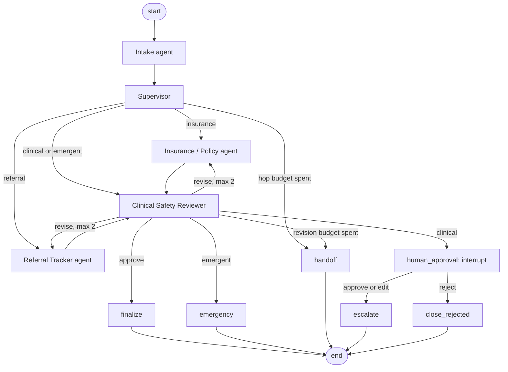

# CareFlow agent team and MCP (M6)

Code: `careflow/team.py` (team graph), `careflow/mcp_server.py` (MCP server),
`careflow/mcp_client.py` (MCP client), `careflow/agent_loop.py` (bounded tool loop).
Tests: `tests/test_team.py`, `tests/test_mcp.py`.
Live evidence: `evals/results/team_test.json` (`python -m evals.team_test`).

## Topology: supervisor plus critic

## Why more than one agent

The four jobs need different tools, different data and different rules:

| Agent | Job | Tools (only these) | Context it gets |
|---|---|---|---|
| Intake | Turn a message into a typed `PatientRequest` | none (structured output) | the raw message |
| Insurance / Policy | Plan, coverage, cost, pre-authorisation | MCP: eligibility, pre-auth, co-pay; local: policy search (M4 RAG) | intake fields, message, saved preferences |
| Referral Tracker | Referral status, SLAs, slots | MCP: referral status, slots, human hand-off; MCP resource: urgency bands | intake fields, message, saved preferences |
| Clinical Safety Reviewer | Check every draft before it reaches the patient | none; MCP resource: clinical SOP | the draft, the tool results, the message |

The main reason is the reviewer. A check is only worth something if it is
independent of the agent that wrote the draft and can send the work back.
One agent holding every tool would review its own work. Splitting insurance
from referrals also keeps each agent's tool list short, so it picks tools
more reliably, and it limits what a mistake or a prompt injection in one
agent can reach.

## Boundaries, enforced in code

- **Tools:** `make_executor` refuses any tool outside the agent's allow-list
  (`TOOL_NOT_ALLOWED`). It also always replaces `patient_ref` with the
  requesting patient, so no agent can read another patient's record. The two
  specialists' tool sets do not overlap.
- **Context:** specialists get `_request_view` (selected intake fields) and
  the message, never another agent's results or the audit log.
- **Writes:** `bounded()` wraps every agent node and raises an error if it
  returns a state key outside its `OWNED_KEYS`.

## Bounded control

- **Routing:** clear cases are routed by code (keywords and the intake
  flags). Unclear ones ask the LLM, and its answer is accepted only if it is
  a legal route (`insurance` or `referral`). Anything else falls back to a
  fixed default.
- **Caps:** at most `CAREFLOW_MAX_TEAM_HOPS` supervisor hops (4) and
  `CAREFLOW_MAX_REVISIONS` revisions (2), plus the graph `recursion_limit`.
  When a budget runs out, the case goes to a human (`handoff`).
- **Critic:** the reviewer first runs code checks (dose wording, diagnosis
  wording, test-result interpretation, and figures that appear in no tool
  result). If those pass, it reads the clinical SOP over MCP and asks the LLM
  for a verdict. A rejected draft goes back to the same agent with the issues
  listed.
- **Critic value, asserted in tests:** an injected "take 50 mg" and an
  invented "$999" are both caught, sent back and corrected
  (`test_reviewer_catches_dosage_advice_and_sends_it_back`,
  `test_reviewer_catches_an_invented_figure`).

## M5 guarantees at team level

The team graph uses the same `SqliteSaver` checkpointer and reuses the M5
`human_approval` (interrupt), `escalate`, `close_rejected` and `hold` nodes.
In the live run, a clinical question paused, was approved from a different
process, and created exactly one escalation.

## MCP server

| Kind | Name | Notes |
|---|---|---|
| Tool | `check_insurance_eligibility`, `check_preauthorization`, `calculate_copay`, `find_appointment_slots`, `get_referral_status`, `flag_for_human` | Typed parameters (patterns, enums, ranges) and docstrings; they wrap `careflow/tools.py` so each rule exists once |
| Resource | `policy://index`, `policy://{slug}`, `careflow://urgency-bands` | The reviewer reads `policy://clinical-escalation`; the Referral Tracker reads `careflow://urgency-bands` |
| Prompt | `clinical_deflection` | Exposed and tested; not yet used by the app |

**Hardening:** patient and referral ids must match strict patterns, and
policy slugs must be listed in `corpus/index.json`, so the caller cannot pass
file paths. The only write is the mock human hand-off record. Logging goes to
stderr (stdout carries the protocol), and `mcp==1.30.0` is pinned. Optional
fields are simplified only in the copy sent to the LLM; the server still
validates every argument against the full schema.

## Live run (committed)

| Case | Route | Tools used | Result |
|---|---|---|---|
| Knee MRI pre-approval and cost (Silver plan) | Insurance agent | MCP pre-auth and co-pay | Answered after review: pre-auth required, 3 business days, $110.00 estimate |
| Referral update | Referral Tracker | MCP referral status, urgency-bands resource | Answered after review: accepted, Routine 5 business days, due 2026-05-05 |
| "Should I stop my tablets?" | Reviewer, then human approval | none | Paused, approved in a new process, escalated once |

9 LLM requests in total.