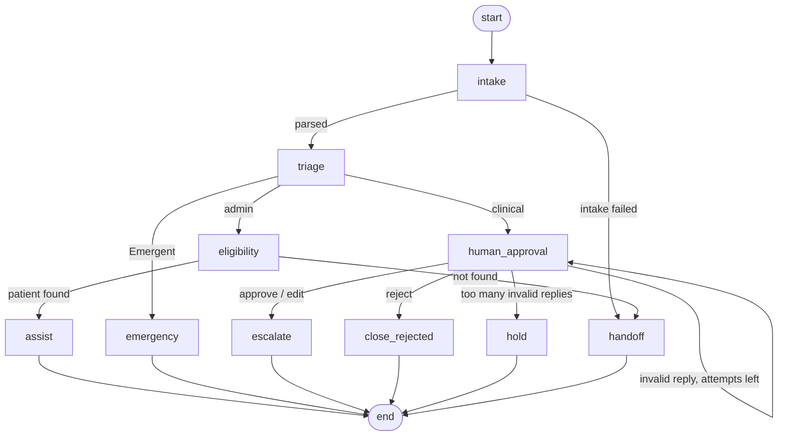

# CareFlow workflow (M5)

Code: `careflow/workflow.py`. Tests: `tests/test_workflow.py` (routers and
nodes tested offline). Restart evidence: `evals/results/restart_test.json`.

## Graph



| Node | Kind | What it does | Reuses |
|---|---|---|---|
| intake | LLM | Message to validated `PatientRequest` | M1 `extract_patient_request` |
| triage | code | Route from typed fields: Emergent, clinical, admin | M1 typed object |
| eligibility | code | Insurance check | M2 `check_insurance_eligibility` |
| assist | LLM agent | Booking, costs, preferences | M2 agent + M3 memory |
| human_approval | interrupt | Staff approve, reject or edit | none |
| escalate | side effect | Clinical triage ticket, once per thread | M3 episodic event |
| emergency | code | Fixed emergency message | M3 episodic event |
| handoff | code | Hand over to staff | M2 `flag_for_human` |

## State and reducers

`CareFlowState` is a typed dict. `audit` uses an append reducer
(`operator.add`), so every node adds to the history and nothing is lost. Every
other key is overwritten: these keys hold the current value, and `route` is
the control field the routers read.

## Why a workflow here, and an agent only in one node

| Step | Decision | Reason |
|---|---|---|
| Read the message | LLM (intake) | Free text is fuzzy; the output is validated by Pydantic |
| Choose the path | Code (`decide_route`) | The rule is fixed by MHP-SOP-401: clinical means escalate, Emergent means emergency |
| Insurance check | Code (tool call) | Always needed for admin requests, so there is no choice to make |
| Answer admin requests | Agent (M2) | Open-ended: the agent picks tools such as slots, co-pay or pre-auth |
| Clinical escalation | Human (interrupt) | Clinical decisions belong to licensed staff, and the escalation cannot be undone |

The order of steps is known in advance, so a fixed graph is safer and easier
to test than letting an agent decide the order. The agent is only used where
the steps really are open-ended.

## Human in the loop

- **Trigger:** any request the intake marks as seeking clinical advice or
  needing human review (MHP-SOP-401 categories A to E).
- **Risk-based gating:** only the clinical path pauses. Admin requests run
  straight through, and so do emergencies, which get a fixed message telling
  the patient to seek emergency care, with no clinical content.
- **Pause:** `interrupt()` returns a payload explaining what is being
  approved (patient, message, urgency, proposed action).
- **Resume:** `Command(resume={...})` with `approve`, `reject` or `edit`
  (edit changes the urgency). Replies are validated by `ApprovalDecision`.
- **Side effect after the interrupt:** the ticket is created in its own node
  (`escalate`), never in `human_approval`, so resuming never repeats it. The
  ticket table also allows only one ticket per `thread_id`.
- **Audit trail:** each decision is logged with approver, time, decision,
  reason and any changed urgency.

## Termination

- The only loop is approval to approval after an invalid reply. It is
  guarded by `approval_attempts` (max `CAREFLOW_MAX_APPROVAL_ATTEMPTS`, 3),
  after which the case goes to `hold`.
- Every run uses an explicit `recursion_limit` (`CAREFLOW_GRAPH_RECURSION_LIMIT`, 25).
- Every path ends at END (see the diagram).

## Durability

`SqliteSaver` saves each step to `data/checkpoints/careflow_graph.sqlite`
(`CAREFLOW_CHECKPOINT_DB`) under the `thread_id`. `python -m evals.restart_test`
runs each step in a new process. Committed result: all 11 checks pass, and the
approved request was resumed in a different process and created exactly one
escalation. A second resume was refused, the rejected request created none,
and the low-risk request did not pause.

## Try it by hand

```
python -m careflow.workflow start --thread demo-1 --patient MHP-P-00000 --channel sms --text "Should I stop my tablets?"
python -m careflow.workflow status --thread demo-1
python -m careflow.workflow resume --thread demo-1 --decision approve --approver "Nurse Rao" --reason "Medication question"
```